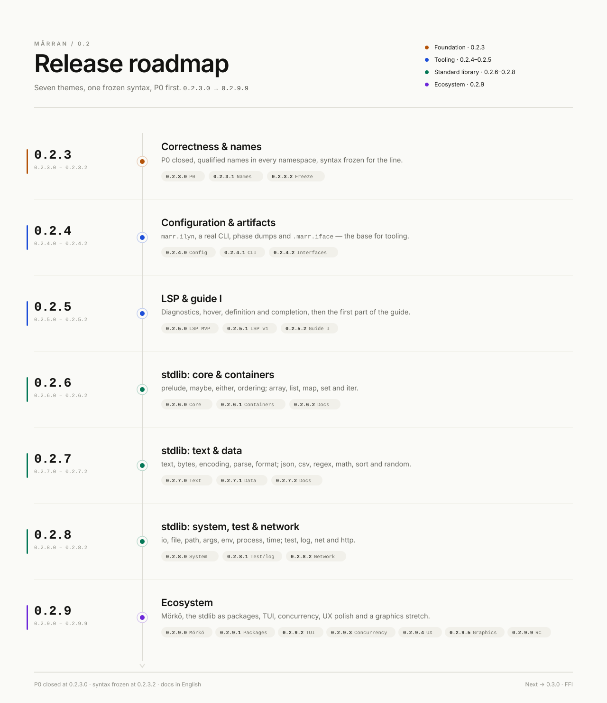

# Roadmap: the 0.2 line

State as of 26 November 2026. Horizon: 0.2.3.2 to 0.2.9.9. The working task
list and implementation details live in `TODO.md`; this file records only
release themes, ordering and exit criteria.

## Decisions behind the plan

- The configuration file is `marr.ilyn`; `marr.av` is rejected.
- The user guide is English only. Russian documents are frozen as an archive;
  there will be no parallel translation.
- `Either` replaces `Result`; `Result` is not introduced even as an alias.
- The full standard library is seven groups:
  1. `prelude`, `maybe`, `either`, `ordering`;
  2. `array`, `list`, `map`, `set`, `iter`;
  3. `text`, `bytes`, `encoding`, `parse`, `format`, `json`, `csv`, `regex`;
  4. `math`, `sort`, `random`;
  5. `io`, `file`, `path`, `args`, `env`, `process`, `time`;
  6. `test`, `log`;
  7. `net`, `http`, `concurrent`, `sync`.
- The exit criterion for 0.2 is closed P0 items. Everything else may move to
  0.3.x without blocking 0.2.9.9.
- FFI stays in 0.3.0. Graphics that needs SDL comes after FFI or remains a
  native-backed stretch release.

## Principles

1. **Correctness first.** The P0 items (`Cell`, `freeze`) are closed before
   the standard library, the LSP and the guide: one does not build a library
   or document a language on an unsound analysis.
2. **The syntax freezes at 0.2.3.2.** After that, only errors and semantics
   change, not the surface of the language. This is the precondition for the
   LSP, the guide and the specification.
3. **Documentation ships with the feature.** The guide is not written in one
   push at the end: every standard-library group and every capability gets
   its chapter and tested examples in the same release.
4. **Package boundaries from the start.** From 0.2.6 each standard-library
   group lives as a separate package in the repository, even before Mörkö
   exists. The split in 0.2.9.1 is publication, not repackaging.
5. **No dead options.** A configuration field exists only when something
   reads it; a flag exists only when it changes something.
6. **One trunk, tags on releases.** After 0.2.2, releases come from one
   integration branch (`0.2-beta`) rather than a branch per version number.

## Versions, branches and CI

- The version is PVP `0.2.x.y`; the tag is `v0.2.x.y`. Before 1.0, patch
  numbers are milestones within a theme; strict PVP patch semantics begin
  after 1.0.
- One release, one theme. Patch milestones within a theme may ship more
  often.
- CI: Linux and Windows, `stack build`/`stack test`, `mkdocs build --strict`,
  doc-example checks, the conformance suite and a link check.
- Every release closes the same way: tests, documentation, changelog, a
  synchronised `marr.ilyn` reference and no dead flags.

## Release overview

| Release | Theme | Content | Criterion |
|---|---|---|---|
| 0.2.3.0 | Correctness | P0: soundness of `Cell`, completeness of `freeze`, property tests | P0 closed (released) |
| 0.2.3.1 | Names | `Name::Name` for types, effects, rows, values and enums; import/export/native; diagnostics; `Pretty` and dumps | qualified names work everywhere (released) |
| 0.2.3.2 | Freeze | conformance suite v1; syntax freeze; documentation of names | the 0.2 syntax is frozen |
| 0.2.4.0 | Configuration | `marr.ilyn`: schema, layers, search, errors, unknown keys, `ConfigPatch` | no dead fields |
| 0.2.4.1 | CLI | `run`/`check`/`dump`/`bench`, `--config`, exit codes, `System.args`, `runUntilPhase` | `marran run` honours the configuration |
| 0.2.4.2 | Artifacts | phase dumps, `.marr.iface` v0, config/CLI reference (EN) | interfaces are usable by the LSP and Mörkö |
| 0.2.5.0 | LSP MVP | diagnostics, hover, definition, completion | works in VS Code on one file |
| 0.2.5.1 | LSP v1 | references, rename, symbols, code actions; interface cache | a multi-file project |
| 0.2.5.2 | Guide I | installation, quickstart, the language (14 chapters) | chapters covered by doc tests |
| 0.2.6.0 | stdlib: core | group 1: `prelude`, `maybe`, `either`, `ordering` | group 1 is stable |
| 0.2.6.1 | stdlib: containers | group 2: `array`, `list`, `map`, `set`, `iter` | group 2 is stable |
| 0.2.6.2 | stdlib: docs | reference, guide chapters, benchmarks | signatures and examples checked |
| 0.2.7.0 | stdlib: text | group 3a: `text`, `bytes`, `encoding`, `parse`, `format` | group 3a |
| 0.2.7.1 | stdlib: data | group 3b: `json`, `csv`, `regex`; group 4: `math`, `sort`, `random` | round-trip and property tests |
| 0.2.7.2 | stdlib: docs | reference, guide chapters, benchmarks | performance budgets met |
| 0.2.8.0 | stdlib: system | group 5: `io`, `file`, `path`, `args`, `env`, `process`, `time` | group 5 |
| 0.2.8.1 | stdlib: test/log | group 6; `marran test`; logging in the configuration | group 6 |
| 0.2.8.2 | stdlib: network | group 7a: `net`, `http`; reference manual draft | group 7a |
| 0.2.9.0 | Mörkö | manifest, lockfile, index, resolver, GitHub Releases + Pages | a project builds from the registry |
| 0.2.9.1 | Packages | the stdlib becomes seven packages, semver, publication, project template | the stdlib installs through Mörkö |
| 0.2.9.2 | TUI | ANSI, `Term`/`Input` effects, the first external package | the TUI installs through Mörkö |
| 0.2.9.3 | Concurrency | `concurrent`, `sync`; experimental | a structured-concurrency demo |
| 0.2.9.4 | UX | `marran new`/`fmt`, errors, `--color`, completions | everyday work |
| 0.2.9.5 | Graphics | SDL through native builtins; stretch | window, events, drawing |
| 0.2.9.9 | RC | re-check P0, conformance, docs, deprecations | the 0.2 line is closed |

## 0.2.3 — correctness and names

**0.2.3.0. P0.** Closed. The `Cell` analysis follows an escaping value into
a declared enumeration and charges a constructor that allocates a `var` field;
`freeze` reaches enum type arguments, partially applied natives and
constructors, and the target of `with`. One case remains a run-time rather
than a static refusal -- a state-bearing record as an enum's type argument --
because a type argument has no effect row; `rebindPath` refuses the write.
Regressions are in `ExamplesSpec` and `FreezeSpec`.

**0.2.3.1. `Name::Name`.** Released. Qualified names work in every namespace:
types, type arguments, effects, rows, values, enumerations, constructors and
effect operations.  `M` is the imported file's header name or its base name;
the declaration must be exported and brought in by the import list.  Types,
rows, effects and type arguments resolve to the local spelling of the import,
constructors in patterns to their declared names, and values and constructors
to real bindings of their own.  The whole native scope keeps each builtin's
declaring module, so `Output::sayn` works and `Numbers::sayn` is refused.
`QualifiedSpec` covers the resolutions, the diagnostics and the walk.

**0.2.3.2. The freeze.** Conformance suite v1 (one test per language rule),
syntax freeze, documentation of names. The future tokens `pattern`, `demands`,
`ensures`, `unwinds`, `${` and `<-` are hard reserved here: a program that uses
them as a name no longer parses. After this release no other new keywords or
forms are added until 0.3.0.

## 0.2.4 — configuration and artifacts

**0.2.4.0. `marr.ilyn`.** A camelCase schema, a `ConfigPatch` whose fields
are all `Maybe`, and real layers: defaults < user < project < env < CLI.
Search order: `--config` → `./marr.ilyn` → upwards from the input file →
`$XDG_CONFIG_HOME` → `~/.config/marr/marr.ilyn` (on Windows,
`%APPDATA%\marr`). Unknown keys are errors; configuration errors are
rendered as diagnostics, not `error`. Logging and limit fields appear only
when they are implemented; until 0.2.8.1 they are absent from the schema.

**0.2.4.1. CLI.** The commands `run`, `check`, `dump` and `bench`; `--run`
remains an alias for `run` during the 0.2 line. `System.args` comes from the
configuration/CLI and reaches `interpretProgram`. `runUntilPhase` writes
dumps through the existing `Pretty`/`Sexp`. Exit codes: 0 for success, 1 for
a program error, 2 for a usage/configuration error, 3 for a type error.

**0.2.4.2. Interfaces.** `.marr.iface` v0: exports, schemes, module
dependencies and a source hash. This is the foundation for the LSP, Mörkö
and the future compiler. Plus a reference for the configuration and the CLI
in English.

## 0.2.5 — the LSP and the first guide

The LSP comes before the whole standard library because it accelerates
everything after it: writing the standard library, the guide and debugging
examples. It already has the frozen syntax, `Name::Name`, the configuration
and interfaces.

**0.2.5.0.** `marran lsp` over stdio: diagnostics (through the same
renderer), hover with the type and effects, go-to-definition, completion.
Start with a full recheck of the file; the interface cache is 0.2.5.1.

**0.2.5.1.** References, rename, document symbols, code actions (imports and
hints). Latency target: a file of 1–2 thousand lines under 300 ms per
change; if that fails, cache interfaces and rebuild modules incrementally.

**0.2.5.2.** Guide, part I: installation, quickstart, CLI, the language
(14 chapters). MkDocs Material, English, GitHub Pages, doc examples in the
tests.

## 0.2.6 — stdlib: core and containers

**0.2.6.0. Group 1.** `prelude`, `maybe`, `either`, `ordering`. Decide
whether the prelude is imported automatically; until then, an explicit
import. `Either` is the main error type: `enum Either[a, b] | Left (value a)
| Right (value b)`.

**0.2.6.1. Group 2.** `array`, `list`, `map`, `set`, `iter`. Fix the
representation of `map`/`set` (persistent or mutable, hash or tree), the
`iter` protocol without type classes (a record of functions or a step enum)
and the laziness semantics of list/iter.

**0.2.6.2. Documentation.** Reference chapters, guide chapters, doc tests,
benchmarks. Signatures in the reference are generated and checked against
`Builtins.names`/`Scope`; the descriptions are written by hand.

## 0.2.7 — stdlib: text and data

**0.2.7.0. Group 3a.** `text`, `bytes`, `encoding`, `parse`, `format`.
`parse` wraps the type-directed `Conv@parse`; define the error policy
(`Either`), the encodings and the formatting of numbers and dates.

**0.2.7.1. Group 3b and 4.** `json`, `csv`, `regex`; `math`, `sort`,
`random`. JSON and CSV get round-trip property tests. Regex has an
explicitly bounded subset of syntax; the implementation may be a native
builtin over a Haskell library.

**0.2.7.2. Documentation and benchmarks.** The reference, guide chapters and
performance budgets for strings and containers.

## 0.2.8 — stdlib: system, tests, network

**0.2.8.0. Group 5.** `io`, `file`, `path`, `args`, `env`, `process`,
`time`. `args` is finally connected to the configuration; `time` covers
monotonic and calendar clocks and formatting.

**0.2.8.1. Group 6.** `test`, `log`; the command `marran test`. Logging
returns to the `marr.ilyn` schema as a working subsystem, not a promise.

**0.2.8.2. Group 7a.** `net`, `http`. Start with TCP and HTTP/1.1 without
TLS; TLS is a separate decision (a native builtin over a Haskell library or
a post-FFI feature). A draft reference manual: grammar, types, effects,
dynamics, configuration.

## 0.2.9 — the ecosystem

**0.2.9.0. Mörkö MVP.** `morko.toml`, `morko.lock`, a git registry index, a
semver resolver, checksums and path/git dependencies. Hosting: tarballs in
GitHub Releases, the index on GitHub Pages, a mirror on Codeberg; later
`ghcr.io`/ORAS. No server of our own is needed.

**0.2.9.1. Packages.** Split the stdlib into seven packages (`std.core`,
`std.text`, …), publish them in the index and add `morko init` and a project
template. This is the first real test of Mörkö.

**0.2.9.2. TUI.** The `tui` package: ANSI rendering, the `Term` and `Input`
effects, line input; raw keys come from a native builtin for Windows and
termios. The first external package installed through Mörkö.

**0.2.9.3. Concurrency.** `concurrent`, `sync`: tasks, channels, mutexes,
structured concurrency. Experimental; if it hits the runtime, it moves to
0.3.x without blocking 0.2.9.9.

**0.2.9.4. UX.** `marran new`, `marran fmt`, coloured diagnostics,
shell completions, editor settings and better suggestions.

**0.2.9.5. Graphics (stretch).** The `gfx` package through SDL2 as a native
builtin: window, events, drawing. If SDL packaging or FFI blocks it, it moves
to 0.3.1.

**0.2.9.9. RC.** Re-check P0, the full conformance suite, the guide and the
reference, deprecations, and fix the list of known limitations and the 0.3.0
plan.

## Why this order

- **P0 → names → freeze.** Everything else rests on sound semantics and a
  stable syntax.
- **Configuration and interfaces → LSP and Mörkö.** Neither tool is possible
  without them; the LSP also speeds up the standard library and the guide.
- **Core stdlib → text → system → network.** Each later group uses the
  earlier ones: text needs `Either` and list/array, json needs text, io needs
  text/either, http needs io/text.
- **Mörkö after package boundaries.** Splitting the stdlib is not
  repackaging; it is the first content of the registry.
- **TUI and graphics after Mörkö.** They need native artifacts and
  dependency distribution; the TUI exercises Mörkö, graphics exercises FFI.

## What changed from the first sketch

| Before | Now |
|---|---|
| 0.2.3: configuration + the whole stdlib + `::` + guide | 0.2.3: P0 + `::` + freeze |
| 0.2.4: LSP + specification | 0.2.4: configuration + CLI + interfaces |
| 0.2.5: Mörkö | 0.2.5: LSP + the first part of the guide |
| 0.2.6: TUI | 0.2.6: stdlib, core and containers |
| 0.2.7: graphics | 0.2.7: stdlib, text and data |
| 0.2.8–0.2.9: stdlib split/UX | 0.2.8: system, tests, network; 0.2.9: Mörkö, packages, TUI, UX |
| The guide as one push in 0.2.3 | The guide incrementally, complete by 0.2.9.9 |
| Specification in 0.2.4 | Reference manual in 0.2.8.2/0.2.9.9; formal semantics after 0.2.9.9 |
| TUI in 0.2.6, graphics in 0.2.7 | TUI in 0.2.9.2, graphics in 0.2.9.5 (stretch) or 0.3.1 |

## After 0.2.9.9

- **0.3.0 — FFI.** The C ABI, `libffi`, dynamic loading, an explicit
  `unsafe` boundary and pointer lifetime rules. The native effect handler as
  the main extension mechanism.
- **0.3.1 — graphics on FFI**, if `gfx` did not ship in 0.2.9.5. It is also
  the test of FFI on a real task.
- **0.3.2 — Contracts (DbC).** `demands` (a pure `Bool` checked before the
  body), `ensures` (a pure `Bool` checked after the body, with the result
  bound) and `unwinds` (an abortive `Error` handler that returns the
  function's result). Desugared to `assert`/`try`: no new runtime, and the
  typing is the existing `assert`/`try` discipline plus a purity check on the
  contract blocks. A failed check raises `Error`, which `unwinds` may catch;
  without `unwinds` the check charges `Error` in the signature, as `assert`
  does. These are runtime checks, not proofs. `old`, `decreases`, `invariant`,
  `variant` and `modifies` are deliberately out of scope: they belong to
  mutation contracts, loops and a future verifier.
  Criterion: a function states a pre- and postcondition and recovers from a
  failed check with `unwinds`.
- **0.3.x — concurrency**, if it slipped; formal semantics; a VM prototype;
  performance.
- **0.4 — first-class patterns.** Patterns become runtime values: creatable
  anywhere, passable, storable in variables and data. A pattern has the type
  `Pattern[I, E, R, ρ]` and the erased public interface
  `View[I, R, ρ] = I -> {ρ} Maybe R`. The stages:
  1. named predicates: `pattern ... = ...` as a value, with statically
     checked exhaustiveness and a mandatory syntactic catch-all `| _ =>`;
  2. an explicit environment `=> { ... }` as a strict projection; arity
     above two nests pairs;
  3. `then` and `View`; `R = Nothing` when there is no `then`;
  4. `<-`: match the named pattern, run its `then`, then match the left
     pattern against the result;
  5. dispatch over lists of `View`, with each pattern's private `E` hidden
     in its closure, so no existentials are needed;
  6. parsers and residual input built on `<-`.

  The prerequisite is shared with the deferred freeze case: `TypeArg` must
  express effect rows, otherwise the pattern type cannot be written. A pure
  `then` can ship first, with the effect row in the type but not yet
  inferred.
- **0.5.0–0.6.0 — the compiler.** `TypedIR` → ANF → CPS → bytecode VM →
  native backend. The interpreter remains the reference; `imm` is a
  `freeze(env)` primitive or a fallback to the interpreter; differential
  tests are mandatory.

## Risks

- **Concurrency** may turn out to be a research task: the scheduler, effects
  and `resume`. Keep it experimental and time-boxed.
- **HTTP/TLS**: without TLS, HTTP is limited; TLS is a separate decision and
  should not be pulled into 0.2.8.2 by default.
- **SDL and native artifacts**: packaging for Windows and Linux is work for
  Mörkö, which is why graphics comes after 0.2.9.0.
- **Standard-library performance** on the interpreter: budgets and
  benchmarks from 0.2.6.2, or `text`/`json` will be unusable.
- **The LSP on a full recheck** may miss the latency target; the interface
  cache is the mandatory fallback.
- **Guide size**: pages and examples are checked by tests, or the guide will
  be stale before it is published.
- **Contracts are runtime checks**, not proofs. The guide and the reference
  must say so, or `ensures` will read as a static guarantee and surprise
  users when `contracts: off` removes the check.
- **First-class patterns** rest on `TypeArg` gaining effect rows. If that
  lands late, the pattern work slips inside 0.4 rather than pulling the
  compiler earlier.
- **One person**: 0.2.9.9 is roughly 15–18 months. If it has to be faster,
  the first candidates to move to 0.3.x are 0.2.9.3 and 0.2.9.5.

## Exit criteria for the 0.2 line

- [ ] P0 is closed (0.2.3.0) and re-checked in 0.2.9.9.
- [x] The syntax is frozen from 0.2.3.2; the conformance suite is green.
- [ ] The future tokens `pattern`, `demands`, `ensures`, `unwinds`, `${` and
      `<-` are hard reserved at the freeze.
- [ ] stdlib groups 1–6 and 7a are ready; 7b is ready or explicitly moved.
- [ ] The guide and the reference manual are in English, with examples
      checked in CI.
- [ ] `marr.ilyn` and the CLI are documented; there are no dead fields or
      flags.
- [ ] LSP v1 works on a multi-file project.
- [ ] Mörkö builds a project from the registry; the stdlib installs as
      packages.
- [ ] The TUI installs through Mörkö; graphics if it made it.
- [ ] The 0.3.0 (FFI) plan is fixed.
